<div align="center">

# CIS Hardening Lab — GNS3
### Auditoría automatizada y hardening de Cisco IOS y FortiGate


</div>

## 🎥 VIDEO DEMOSTRATIVO

<p align="center">
  <a href="https://youtu.be/ELAJC6O323o">
    
  </a>
</p>

---

## Propósito del laboratorio

Este laboratorio implementa en GNS3 un escenario de seguridad de redes compuesto por un router Cisco c7200, un switch Cisco IOSvL2, un firewall FortiGate 7.0.9 y un contenedor Docker de administración.

El propósito es evaluar la configuración de seguridad de los dispositivos mediante controles inspirados en CIS Benchmarks, automatizar la aplicación de remediaciones seleccionadas y validar el resultado mediante pruebas externas de conectividad, puertos y protocolos TLS.

La herramienta desarrollada ofrece dos modos principales:

1. **Audit:** recopila información y genera informes sin modificar la configuración.
2. **Apply:** respalda la configuración, aplica las remediaciones detectadas y genera un informe posterior con estados antes/después y diferencias.

El proyecto también incorpora un wrapper de comandos, inventario de dispositivos, receptor syslog y un script de verificación.

## Objetivos técnicos

- Auditar configuraciones de Cisco IOS y FortiGate 7.0.x.
- Identificar configuraciones débiles en el plano de administración y servicios expuestos.
- Fortalecer autenticación, autorización y acceso remoto.
- Reducir la exposición de Telnet, HTTP y servicios de administración innecesarios.
- Restringir las fuentes autorizadas para administrar los dispositivos.
- Mejorar el registro de eventos y tráfico.
- Restringir la administración del FortiGate desde su interfaz WAN.
- Generar respaldos, informes HTML/JSON y diferencias entre configuración inicial y posterior.
- Verificar los servicios mediante pruebas desde el contenedor de gestión.

## Topología

### Captura del proyecto en GNS3

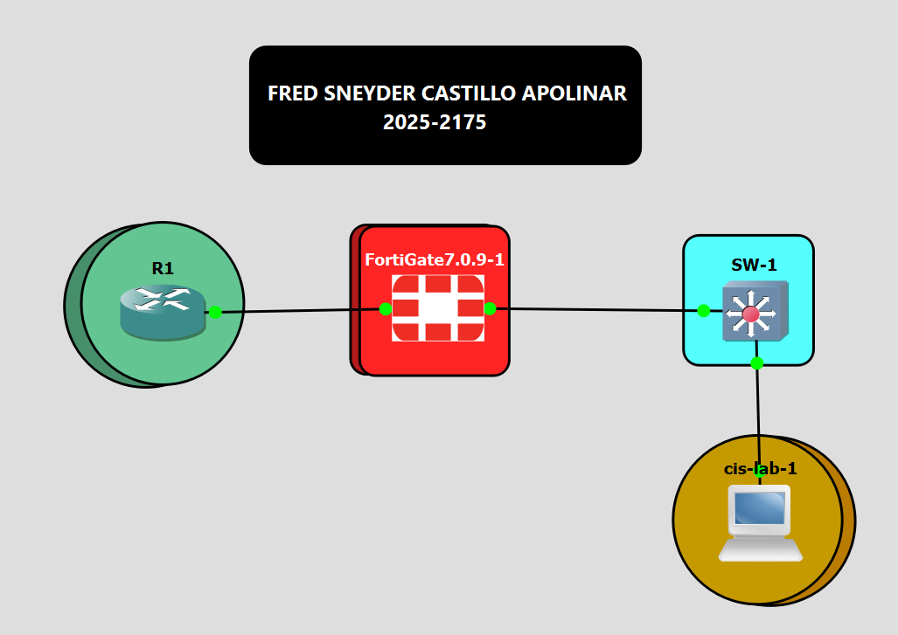

### Diagrama lógico

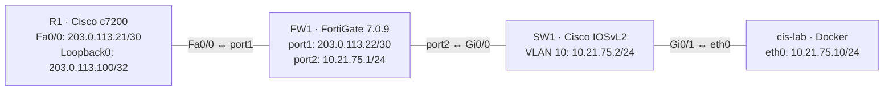

### Tabla de direccionamiento

| Nodo | Interfaz | Dirección IP | Función |
|---|---|---:|---|
| R1 | FastEthernet0/0 | `203.0.113.21/30` | Enlace con la interfaz WAN de FW1 |
| R1 | Loopback0 | `203.0.113.100/32` | Dirección de referencia de la red simulada |
| FW1 | port1 | `203.0.113.22/30` | Interfaz WAN |
| FW1 | port2 | `10.21.75.1/24` | Gateway de la LAN |
| SW1 | VLAN 10 | `10.21.75.2/24` | Administración del switch |
| cis-lab | eth0 | `10.21.75.10/24` | Equipo de gestión y auditoría |

**Red de tránsito:** `203.0.113.20/30`  
**Red LAN:** `10.21.75.0/24`

### Enlaces entre nodos

| Origen | Interfaz | Destino | Interfaz |
|---|---|---|---|
| R1 | FastEthernet0/0 | FW1 | port1 |
| FW1 | port2 | SW1 | GigabitEthernet0/0 |
| SW1 | GigabitEthernet0/1 | cis-lab | eth0 |

## Componentes del laboratorio

| Elemento | Plataforma | Función |
|---|---|---|
| R1 | Cisco c7200 / IOS 15.2(4)S6 | Router de borde simulado y origen de prueba externa |
| SW1 | Cisco IOSvL2 | Conmutación y acceso de gestión LAN |
| FW1 | FortiGate VM64-KVM 7.0.9 build 0444 | Firewall perimetral |
| cis-lab | Docker | Automatización, verificación y recepción de logs |
| hardening_cis.py | Python / Netmiko | Evaluación y aplicación de controles |
| cis-lab | Bash | Interfaz unificada de comandos |
| verify.sh | Bash / netcat / OpenSSL | Pruebas de puertos y TLS |

## Arquitectura de automatización

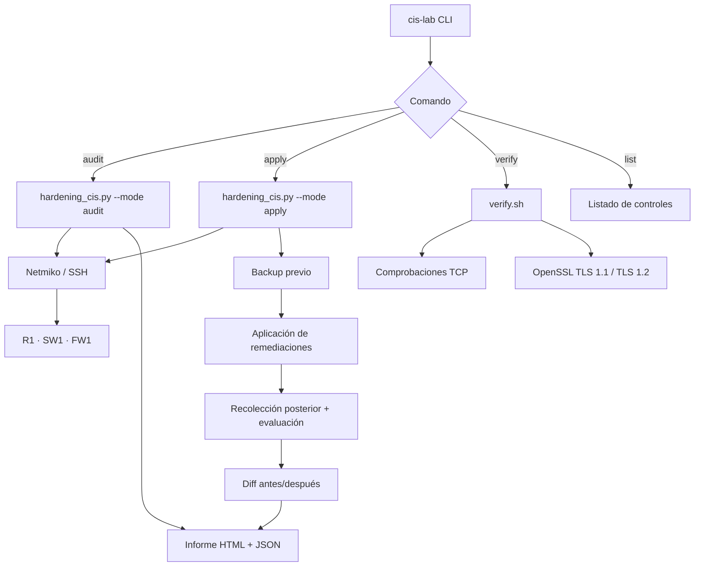

## Metodología de auditoría y hardening

### Auditoría — `cis-lab audit`

1. Se carga el inventario de dispositivos.
2. Se establecen conexiones de administración.
3. Se recopilan salidas de comandos de cada equipo.
4. Se ejecutan los evaluadores de controles.
5. Se calcula un puntaje ponderado por severidad.
6. Se generan informes HTML y JSON.

Este modo no envía comandos de configuración a los dispositivos.

### Aplicación — `cis-lab apply`

1. Solicita confirmación mediante la palabra `APLICAR`.
2. Obtiene el estado inicial.
3. Guarda una copia de la configuración antes de modificarla.
4. Aplica los comandos asociados a los controles que están en `FAIL`.
5. En Cisco, intenta abrir una nueva sesión para comprobar conectividad antes de guardar.
6. Vuelve a recopilar la configuración.
7. Calcula el estado posterior y el diff.
8. Genera el informe HTML y JSON.

### Estados de control

| Estado | Interpretación |
|---|---|
| `PASS` | El control se considera cumplido |
| `FAIL` | El evaluador detecta un incumplimiento |
| `MANUAL` | Requiere intervención manual |
| `ERROR` | No fue posible evaluar el control |
| `EXCEPCION` | Incumplimiento excluido del cómputo mediante una excepción documentada |

El puntaje pondera Alta = 3, Media = 2 y Baja = 1. Las excepciones documentadas no suman ni restan puntos.

## Controles de seguridad

### Cisco IOS — R1 y SW1

El motor incluye verificaciones y remediaciones para:

- `enable secret` y eliminación de `enable password`.
- Usuarios locales con `secret` y privilegio 1.
- AAA: `aaa new-model` y listas de autenticación.
- Acceso remoto SSH-only en líneas VTY.
- ACL de acceso a VTY.
- Tiempos de inactividad en consola, AUX y VTY.
- Banners de acceso.
- Deshabilitación de SNMP cuando no es requerido.
- Hostname y dominio.
- Llaves RSA de 2048 bits y SSH versión 2.
- Timeout y reintentos de autenticación SSH.
- Deshabilitación de CDP, BOOTP, DHCP local e interfaz web IOS.
- TCP keepalives.
- Logging, buffer, syslog y timestamps.
- `no ip source-route` y `no ip proxy-arp`.
- Controles L2 complementarios para switch: DTP, VLAN nativa, puertos no utilizados, PortFast y BPDU Guard.

### FortiGate 7.0.9 — FW1

El motor evalúa:

- Banners pre-login y post-login.
- Hostname y NTP.
- Política de contraseñas.
- Umbral y duración de bloqueo administrativo.
- Timeout de inactividad.
- Cifrado administrativo y versiones TLS.
- Agente SNMP.
- Servicios HTTP y Telnet en `allowaccess`.
- Trusted hosts para administradores.
- Envío de syslog.
- Registro de tráfico de políticas.
- Administración permitida en la interfaz WAN.

El cambio de nombre de la cuenta `admin` predeterminada se registra como `MANUAL`.

## Inventario de dispositivos

El inventario utilizado se conserva en [`inventory/inventory.json`](inventory/inventory.json).

| Equipo | Host de gestión | Plataforma | Red/origen autorizado |
|---|---|---|---|
| R1 | `203.0.113.21` | `cisco_ios` | `203.0.113.22/32` |
| SW1 | `10.21.75.2` | `cisco_ios` | `10.21.75.10/32` |
| FW1 | `10.21.75.1` | `fortinet` | `10.21.75.10/32` |

R1 contiene una excepción para el control `C-31` de syslog remoto. El inventario documenta que R1 es el router de borde y utiliza su buffer local como mecanismo de registro.

## Verificación técnica

El script [`scripts/verify.sh`](scripts/verify.sh) utiliza `nc` para comprobar los puertos TCP y `openssl s_client` para verificar negociación TLS con la GUI HTTPS de FortiGate.

| Equipo | Puerto | Servicio | Estado objetivo |
|---|---:|---|---|
| R1 | 23/TCP | Telnet | Cerrado |
| R1 | 80/TCP | HTTP | Cerrado |
| R1 | 22/TCP | SSH | Abierto |
| SW1 | 23/TCP | Telnet | Cerrado |
| SW1 | 80/TCP | HTTP | Cerrado |
| SW1 | 22/TCP | SSH | Abierto |
| FW1 | 23/TCP | Telnet | Cerrado |
| FW1 | 80/TCP | HTTP | Cerrado |
| FW1 | 22/TCP | SSH | Abierto |
| R1 | 443/TCP | HTTPS | Cerrado |
| FW1 LAN | 443/TCP | GUI HTTPS | Abierto |

### Pruebas TLS del script

| Prueba | Resultado esperado |
|---|---|
| FW1 TLS 1.1 | Rechazado |
| FW1 TLS 1.2 | Negociado |

El script inspecciona si OpenSSL recibe un certificado (`BEGIN CERTIFICATE`). Si no encuentra el texto `no protocols available`, clasifica otros errores de handshake como rechazo. Por esta razón, un resultado debe interpretarse junto con la salida detallada y la conectividad del servicio.

### Prueba perimetral manual

R1 simula el segmento externo no confiable. Desde la CLI de R1:

```text
R1# telnet 203.0.113.22 443
R1# telnet 203.0.113.22 22
```

Después del hardening, la administración del FortiGate no debe estar disponible desde su interfaz WAN.


## Ejecución del laboratorio

### Comandos principales

```bash
cis-lab help
cis-lab list
cis-lab audit
cis-lab apply
cis-lab verify
cis-lab verify --nmap
cis-lab syslog
cis-lab logs
cis-lab shell
```

### Secuencia de trabajo

```bash
# Auditoría inicial sin modificar los dispositivos
cis-lab audit

# Pruebas externas antes del hardening
cis-lab verify

# Aplicación de remediaciones; confirmar escribiendo APLICAR
cis-lab apply

# Verificación externa posterior
cis-lab verify

# Auditoría posterior
cis-lab audit
```

### Ejecución selectiva

```bash
cis-lab audit --only R1,SW1
cis-lab apply --only R1,SW1
```

### Configuración de red del contenedor

Si GNS3 no aplica la dirección de red configurada en la plantilla:

```bash
cis-lab ip 10.21.75.10/24 10.21.75.1
```

### Listado de controles

```bash
cis-lab list
```

## Informes y respaldos

Los archivos de salida se generan en `/work/informes/`:

- `informe_audit_*.html`
- `informe_audit_*.json`
- `informe_apply_*.html`
- `informe_apply_*.json`
- `backup_R1_*.cfg`
- `backup_SW1_*.cfg`
- `backup_FW1_*.cfg`
- `verify_*.txt`

Los respaldos se producen antes de aplicar los cambios. Los informes de modo `apply` incluyen los resultados antes/después y la diferencia entre las configuraciones recopiladas.

## Evidencias del laboratorio

Las capturas se referencian directamente en las secciones donde corresponden. Al añadir los archivos a `images/` con estos nombres, GitHub los mostrará automáticamente.

| Archivo | Evidencia |
|---|---|
| `01-topology-gns3.png` | Topología completa del proyecto en GNS3 |
| `02-r1-fw1-addressing.png` | Interfaces e IP de R1 y FW1 |
| `03-sw1-cis-lab-addressing.png` | IP de gestión de SW1 y contenedor |
| `04-audit-before.png` | Informe HTML de auditoría inicial |
| `05-verify-before.png` | Resultados de `verify` antes del hardening |
| `06-apply-execution.png` | Proceso de aplicación de controles |
| `07-audit-after.png` | Informe HTML de auditoría posterior |
| `08-verify-after.png` | Resultados de `verify` posteriores |
| `09-wan-management-blocked.png` | Intento de administración WAN desde R1 |
| `10-ssh-acl-syslog.png` | Banner SSH, ACL VTY y recepción syslog |

### Topología


### Direccionamiento

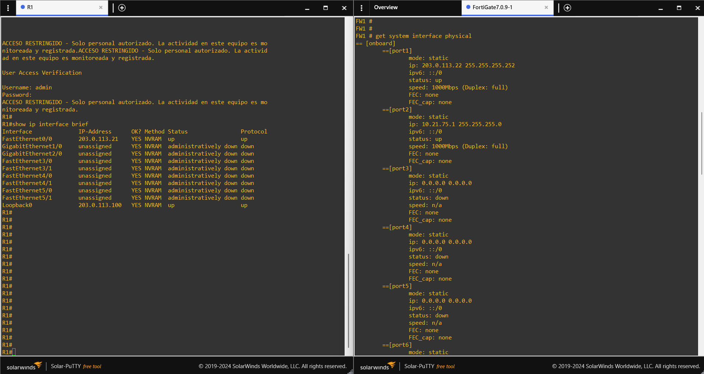

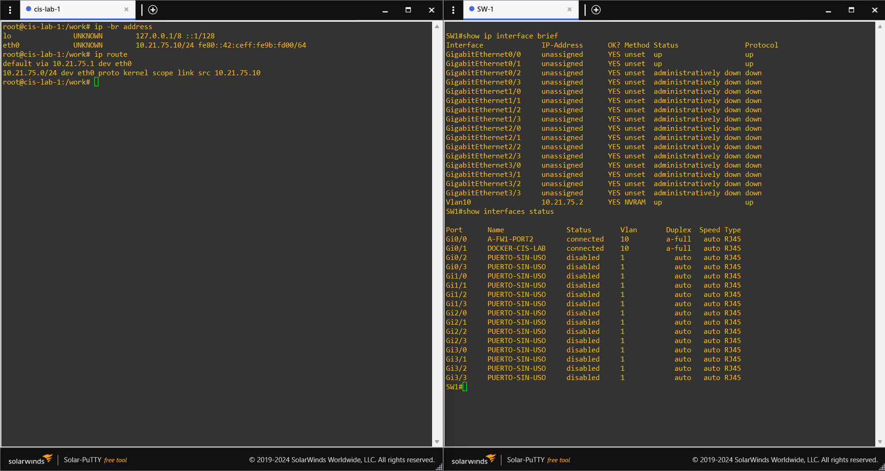

### Auditoría y aplicación

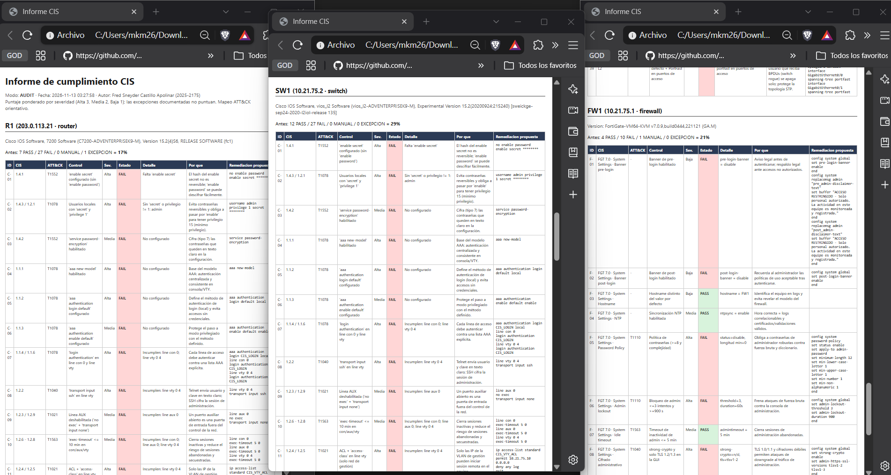

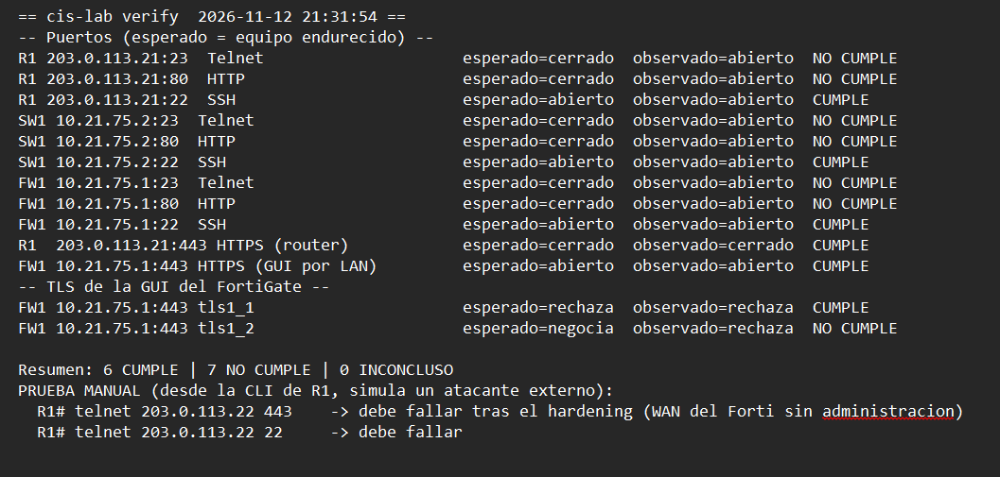

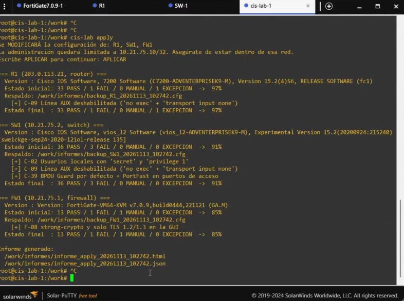

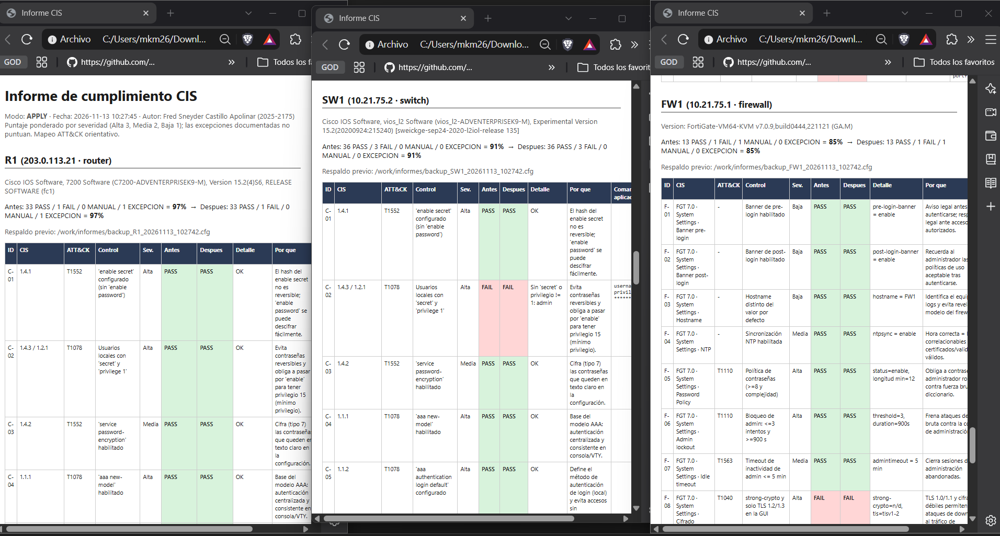

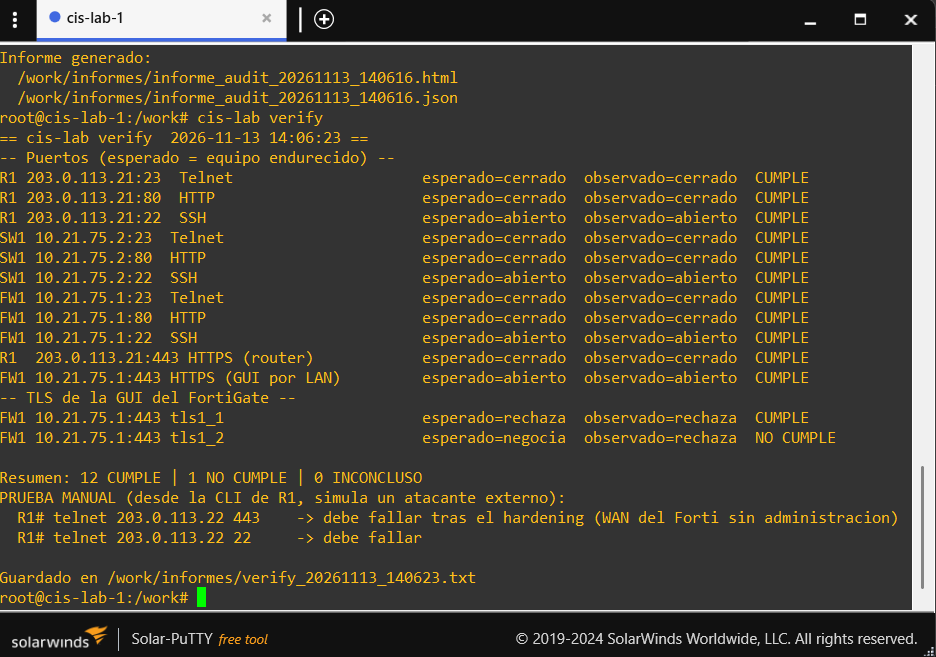

### Administración y registros


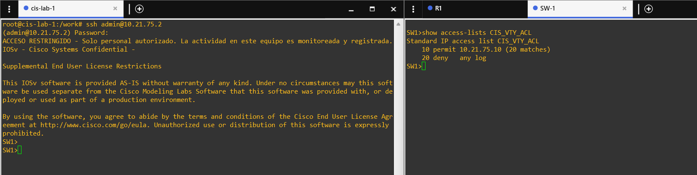

## Running-configs

Las configuraciones iniciales se encuentran en [`configs/before/`](configs/before/). La carpeta [`configs/after/`](configs/after/) contiene los extractos posteriores que se pudieron documentar a partir de la evidencia disponible.

Los archivos completos posteriores deben exportarse desde el estado final de los equipos y añadirse a `configs/after/` con estos nombres:

- `R1-running-config-after.cfg`
- `SW1-running-config-after.cfg`
- `FW1-full-configuration-after.conf`

## Documentación técnica

| Documento | Contenido |
|---|---|
| [`docs/01-architecture.md`](docs/01-architecture.md) | Arquitectura, diagramas y conexiones |
| [`docs/02-addressing-and-topology.md`](docs/02-addressing-and-topology.md) | Direccionamiento y topología |
| [`docs/03-r1-router.md`](docs/03-r1-router.md) | Configuración inicial y seguridad de R1 |
| [`docs/04-sw1-switch.md`](docs/04-sw1-switch.md) | Configuración inicial y controles L2 de SW1 |
| [`docs/05-fw1-fortigate.md`](docs/05-fw1-fortigate.md) | Configuración inicial y hardening FortiGate |
| [`docs/06-automation.md`](docs/06-automation.md) | Arquitectura y referencia de scripts |
| [`docs/07-validation.md`](docs/07-validation.md) | Pruebas técnicas y TLS |
| [`docs/08-running-configs.md`](docs/08-running-configs.md) | Organización de configuraciones antes/después |
| [`docs/09-docker-management-node.md`](docs/09-docker-management-node.md) | Contenedor cis-lab e integración GNS3 |

## Consideraciones

- Los controles y sus referencias se documentan tal como están implementados en el script. La correspondencia numérica exacta debe contrastarse con la edición oficial del CIS Benchmark aplicable.
- Los controles L2 complementarios del switch se identifican como complementarios en el código.
- El mapeo de MITRE ATT&CK del informe es orientativo.
- Las configuraciones iniciales débiles se utilizaron para demostrar detección y remediación dentro del laboratorio aislado.
- Las contraseñas de laboratorio y otros secretos no forman parte de este repositorio.
- Este proyecto no está afiliado ni respaldado por CIS.


## 👨‍💻 Autor

**Fred Castillo**  
*Tecnólogo en Seguridad Informática*  
*Red Team | Seguridad Ofensiva*

[](https://www.linkedin.com/in/fredcastillo11/) [](https://github.com/fredcastillo)
[](https://hub.docker.com/u/fredcastillo)
