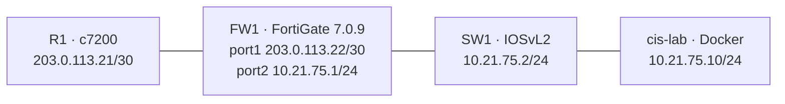
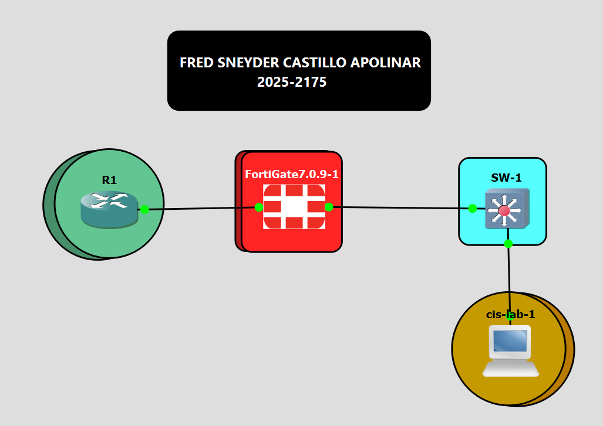

# 01 — Arquitectura

## Propósito

El laboratorio conecta tres dispositivos de red —router Cisco, firewall FortiGate y switch Cisco— con un contenedor Docker de administración. El contenedor ejecuta las auditorías, las remediaciones y las pruebas de verificación.

## Diagrama

## Roles

- **R1:** router de borde simulado y origen de pruebas desde el segmento WAN.
- **FW1:** firewall que conecta el segmento de tránsito con la LAN de gestión.
- **SW1:** switch de acceso que interconecta el firewall y el contenedor.
- **cis-lab:** nodo de administración, auditoría automatizada, verificación TCP/TLS y syslog.

