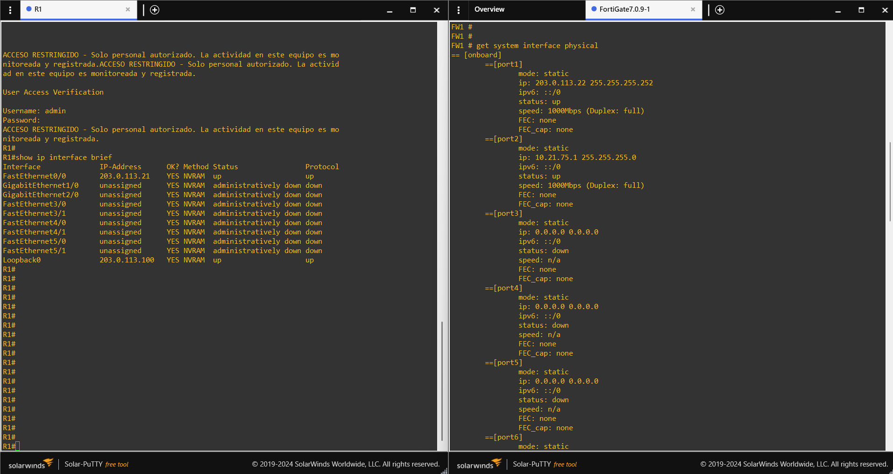
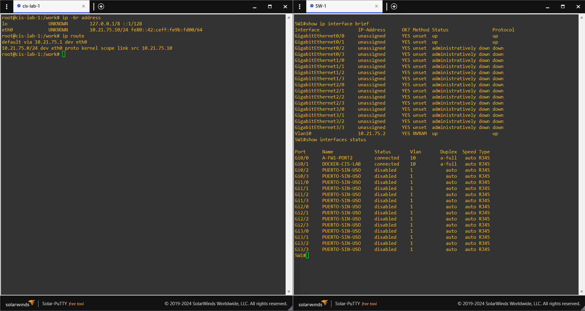

# 02 — Direccionamiento y topología

| Nodo | Interfaz | Dirección | Uso |
|---|---|---|---|
| R1 | FastEthernet0/0 | `203.0.113.21/30` | Tránsito a FW1 |
| R1 | Loopback0 | `203.0.113.100/32` | Dirección de red simulada |
| FW1 | port1 | `203.0.113.22/30` | WAN |
| FW1 | port2 | `10.21.75.1/24` | LAN |
| SW1 | VLAN 10 | `10.21.75.2/24` | Gestión |
| cis-lab | eth0 | `10.21.75.10/24` | Gestión |

- Red de tránsito: `203.0.113.20/30`
- Red LAN: `10.21.75.0/24`

## Cableado de GNS3

| Origen | Destino |
|---|---|
| R1 FastEthernet0/0 | FW1 port1 |
| FW1 port2 | SW1 GigabitEthernet0/0 |
| SW1 GigabitEthernet0/1 | cis-lab eth0 |

