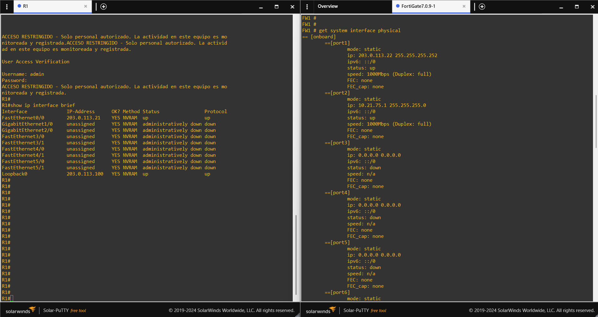

# 03 — R1: Cisco c7200

## Función

R1 actúa como router de borde simulado, conectado a la WAN del FortiGate. También se utiliza como punto de origen para comprobar que la administración WAN del firewall no esté disponible desde el segmento externo.

## Identificación y direccionamiento inicial

```text
enable
configure terminal
hostname R1
no ip domain-lookup
ip domain-name lab.local
username admin privilege 15 password <LAB_PASSWORD>
enable password <LAB_PASSWORD>

interface Loopback0
 description INTERNET-SIMULADA
 ip address 203.0.113.100 255.255.255.255

interface FastEthernet0/0
 description ENLACE-A-FW1-PORT1
 ip address 203.0.113.21 255.255.255.252
 no shutdown

ntp master 3
snmp-server community public RO
ip http server

line con 0
 exec-timeout 0 0
 logging synchronous

line vty 0 4
 login local
 transport input all
end
```

La preparación inicial de SSH utilizó una llave RSA de 1024 bits y SSH versión 2:

```text
configure terminal
crypto key generate rsa general-keys modulus 1024
ip ssh version 2
end
write memory
```

## Controles Cisco

El script evalúa credenciales, AAA, líneas de acceso, SSH, servicios innecesarios, logging y controles del plano de datos.

La excepción `C-31` se define en el inventario: al tratarse del router de borde, no envía syslog remoto a la red privada y utiliza su buffer local.

## Verificación de VTY

Extracto observado en el estado endurecido:

```text
line vty 0 4
 access-class CIS_VTY_ACL in
 exec-timeout 5 0
 login authentication CIS_LOGIN
 transport input ssh
```

Comandos de consulta:

```text
show ip interface brief
show running-config
show running-config | section line vty
show access-lists CIS_VTY_ACL
show ip ssh
show logging
```


