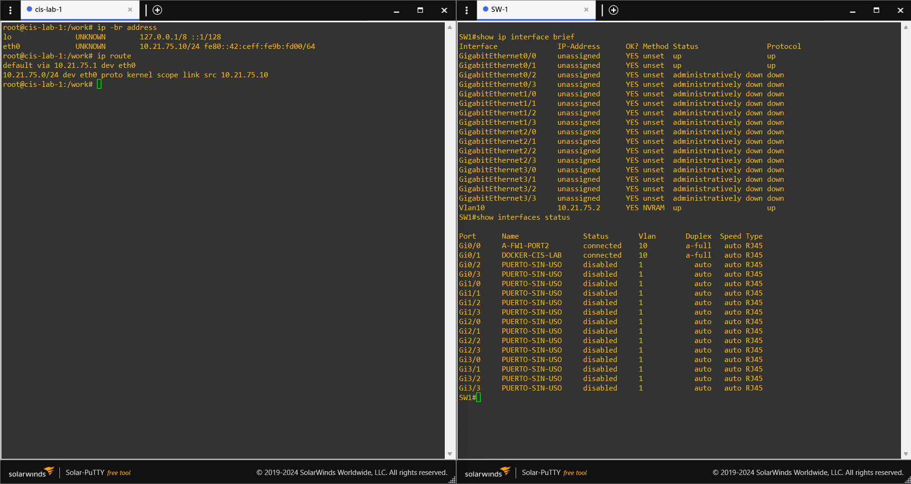

# 04 — SW1: Cisco IOSvL2

## Función

SW1 proporciona conectividad de capa 2 entre la interfaz LAN del FortiGate y el contenedor cis-lab. La administración del switch utiliza la SVI VLAN 10.

## Configuración inicial

```text
enable
configure terminal
hostname SW1
no ip domain-lookup
ip domain-name lab.local
username admin privilege 15 password <LAB_PASSWORD>
enable password <LAB_PASSWORD>

vlan 10
 name LAN

interface Vlan10
 ip address 10.21.75.2 255.255.255.0
 no shutdown

ip default-gateway 10.21.75.1

interface GigabitEthernet0/0
 description A-FW1-PORT2
 switchport mode access
 switchport access vlan 10

interface GigabitEthernet0/1
 description DOCKER-CIS-LAB
 switchport mode access
 switchport access vlan 10

line con 0
 exec-timeout 0 0
 logging synchronous

line vty 0 4
 login local
 transport input all
end
```

Preparación inicial de SSH:

```text
configure terminal
crypto key generate rsa general-keys modulus 1024
ip ssh version 2
end
write memory
```

## Controles complementarios L2

El motor incluye controles complementarios para:

- Deshabilitar DTP en troncales (`switchport nonegotiate`).
- Utilizar una VLAN nativa distinta de VLAN 1 en interfaces trunk.
- Apagar interfaces físicas sin uso.
- Habilitar BPDU Guard por defecto y PortFast en puertos de acceso.

Estos controles se identifican como complementarios L2 en el listado de controles del script.

## Comandos de verificación

```text
show ip interface brief
show interfaces status
show running-config
show access-lists CIS_VTY_ACL
show spanning-tree summary
```


