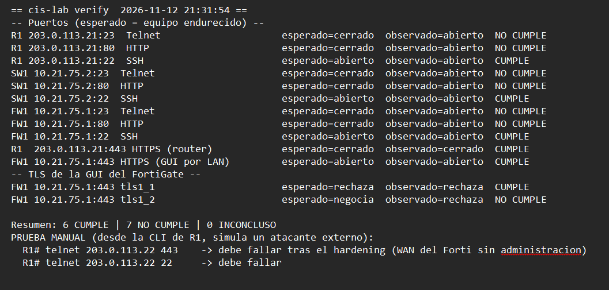
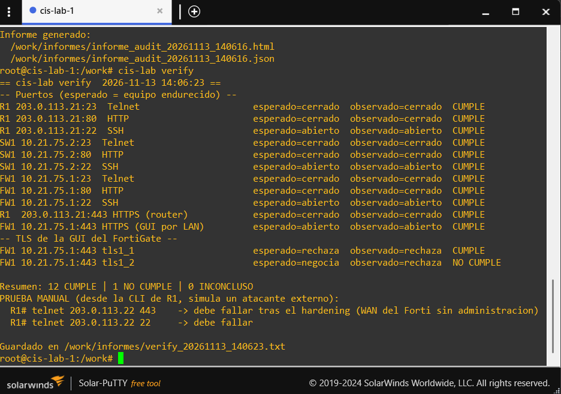

# 07 — Validación técnica

## Comprobaciones TCP

`verify.sh` ejecuta `nc -z -w 3` para determinar si los puertos están abiertos o cerrados.

| Equipo | Puerto | Servicio | Resultado esperado |
|---|---:|---|---|
| R1 | 23 | Telnet | Cerrado |
| R1 | 80 | HTTP | Cerrado |
| R1 | 22 | SSH | Abierto |
| SW1 | 23 | Telnet | Cerrado |
| SW1 | 80 | HTTP | Cerrado |
| SW1 | 22 | SSH | Abierto |
| FW1 | 23 | Telnet | Cerrado |
| FW1 | 80 | HTTP | Cerrado |
| FW1 | 22 | SSH | Abierto |
| R1 | 443 | HTTPS router | Cerrado |
| FW1 LAN | 443 | HTTPS GUI | Abierto |

## Comprobaciones TLS

El script ejecuta:

```bash
echo | timeout 10 openssl s_client -connect "$FW1:443" -tls1_1 -cipher 'ALL:@SECLEVEL=0'
echo | timeout 10 openssl s_client -connect "$FW1:443" -tls1_2 -cipher 'ALL:@SECLEVEL=0'
```

La negociación se identifica cuando la salida contiene `BEGIN CERTIFICATE`. El texto `no protocols available` se clasifica como `INCONCLUSO`. Otros errores son clasificados por el script como rechazo.

## Nmap opcional

```bash
cis-lab verify --nmap
```

Esta opción agrega un escaneo TCP de puertos 22, 23, 80 y 443 para R1, SW1 y FW1. El escaneo Nmap no sustituye las comprobaciones TLS realizadas por OpenSSL.

## Prueba WAN desde R1

```text
R1# telnet 203.0.113.22 443
R1# telnet 203.0.113.22 22
```

El acceso administrativo al FortiGate no debe estar expuesto desde el enlace WAN.




